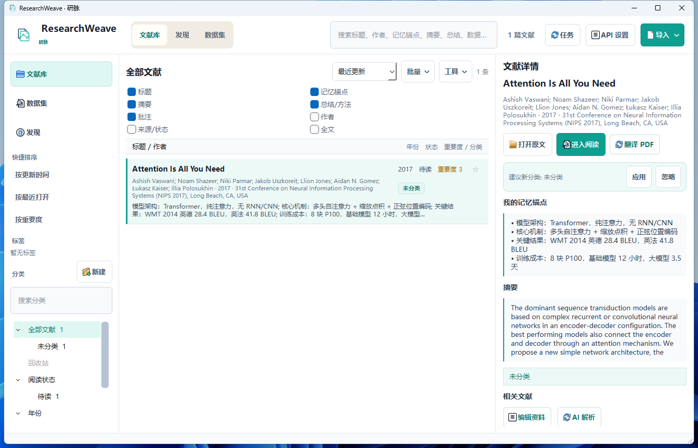
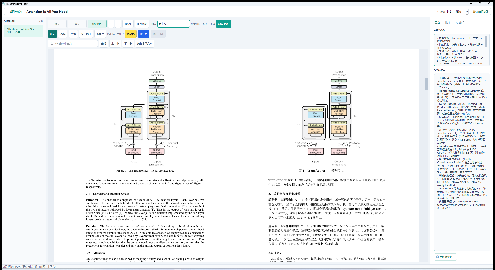
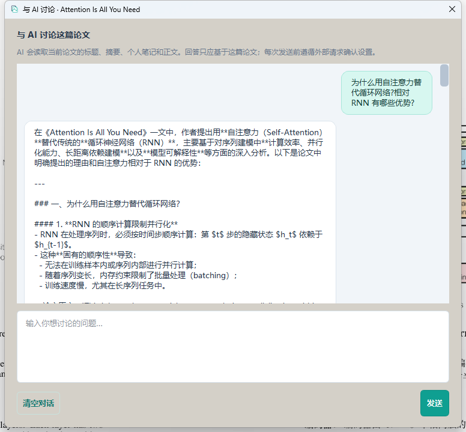
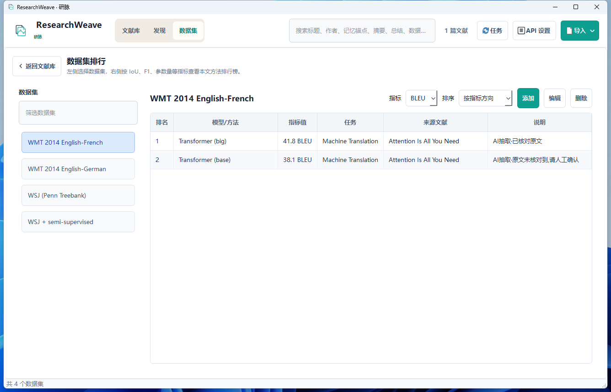
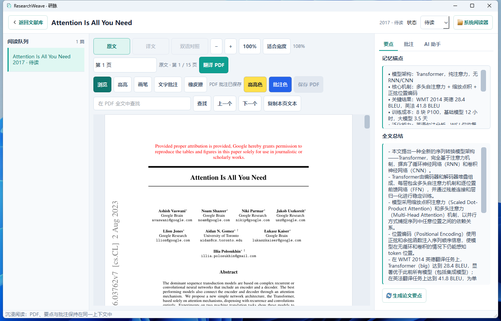
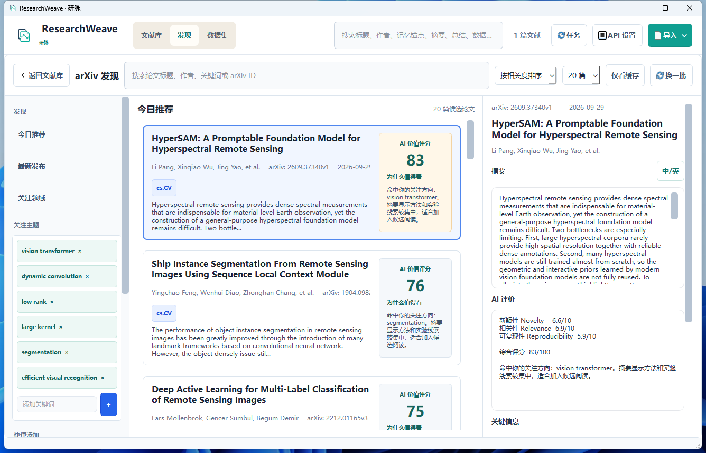
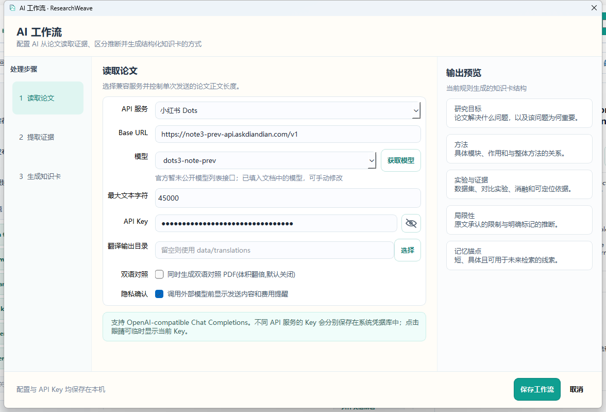

# ResearchWeave · 研脉

**一款跑在你自己电脑上的科研文献工作台:找论文、读论文、翻译论文、整理实验数据,全流程一个应用。**

(Windows · Python 3.11 · AGPL-3.0)



如果你的日常是:追 arXiv 新论文、硬盘里躺着几十篇只读了摘要的 PDF、为了读英文文献开着重型翻译软件来回切换、实验数据散落在论文和表格里对不上号——研脉就是为这些时刻准备的。本质上,它是一个内置了 PDF 翻译与 AI 精读能力的本地文献管理器(reference manager)。

## 它能帮你做什么

**📥 论文进得来**
- 粘贴一个 arXiv ID 或 DOI,标题、作者、摘要自动补全,PDF 一键获取;
- arXiv 发现页按你关注的研究主题每日推荐新论文,并附 AI 预评分(新颖性/相关性),顺眼的直接入库。

**🧠 论文读得快**
- 一键 AI 解析:自动生成结构化知识卡——研究目标、方法、实验证据、局限性,先把一篇论文的骨架看明白,再决定要不要精读;
- 与论文对话:阅读器里随时提问("方法为什么有效?""如何复现?"),AI 只基于这篇论文回答,并引用原文依据;
- AI 自动抽取论文中的实验数据集与指标(如 BLEU、IoU、F1),**逐条与论文原文核对**,核对不上的明确标出"请人工确认",不让你被幻觉数据坑到;
- 数据集排行榜:不同论文在同一数据集上的成绩自动横向对比,谁的方法更强一目了然。

**🌐 外文读得懂**
- 整篇 PDF 翻译(基于开源 BabelDOC),保留原文排版、公式与图表,译文/双语对照随你选;
- 支持批量:选中多篇文献一次入队,队列可取消、可重试;
- 每次翻译的真实 token 用量落盘统计,花了多少一目了然。

**✍️ 读过的留得下**
- 内置 PDF 阅读器:高亮、画笔、文字批注,和 AI 要点、记忆锚点同屏;
- 每篇论文记一句"最值得记住的话",日后检索一眼想起它;
- 真实阅读时长按天累计,读够了自动把"待读"升级成"已读",阅读状态不用手动维护。

**🗄️ 数据管得住**
- 一切数据(文献库、PDF、译文、批注、统计)都在**你自己电脑的数据目录**里,卸载即带走,无账号无云端;
- 整库备份 / 恢复:一次打包全部用户数据,换电脑不丢东西;
- 存储管理:哪里占了多少空间、哪些是可清理的垃圾,一目了然。

## 三步上手

1. **下载**:从 [Releases](../../releases) 下载 `ResearchWeave-Windows-x64-slim.zip`,解压后运行其中的 `ResearchWeave.exe`(也可从源码运行,见文末);
2. **配置 AI**:启动后点右上角「API 设置」,选择 API 服务并填入你的 API Key(任何 OpenAI 兼容服务均可;Key 保存在 Windows 凭据管理器,不落明文);
3. **导入第一篇论文**:点「导入 → 按 DOI / arXiv 添加」,粘贴一个 ID(比如 `1706.03762`),开始使用。

> 不用 AI 功能?文献管理、阅读器、备份这些本地能力照常可用。AI 只在你主动点击时才会被调用,且每次调用前都弹出确认框,明示发什么、发给谁。

## 示例:用《Attention Is All You Need》走一遍

以深度学习经典论文 [Attention Is All You Need](https://arxiv.org/abs/1706.03762)(arXiv:1706.03762)为例:

1. **入库**:「导入 → 按 DOI / arXiv 添加」,粘贴 arXiv 链接(如 `https://arxiv.org/abs/1706.03762`)或 DOI、裸 arXiv ID,元数据与摘要自动补全;
2. **获取 PDF**:文献详情页点「获取 PDF」;
3. **AI 解析**:一键生成知识卡——模型架构、多头注意力机制、训练成本、开源代码链接等要点直接呈现在文献卡片上;
4. **数据集排行榜**:解析出的 **WMT 2014 英法 41.8 BLEU**、英德 **28.4 BLEU** 自动进入「数据集」页,标注"AI 抽取·已核对原文";
5. **沉浸阅读**:批注、AI 全文总结、记忆锚点同屏,读完自动累计时长;
6. **翻译成中文**:点「翻译 PDF」,排版保真的译文直接挂进阅读器,原文/译文/双语对照一键切换。

### PDF 翻译:原文/译文同屏对照

翻译完成后无需离开阅读器——双语对照视图下,左页英文原版、右页中文译文:图表原样保留,图注同步翻译,公式与排版不动:



### 与论文对话

阅读器的「AI 助手」标签页里,随时就当前论文提问。AI 只基于这篇论文的内容回答,并引用原文依据:



### 数据集排行榜



### 沉浸阅读器



### arXiv 发现页



### API 工作流设置



## 常见问题

**我的数据存在哪里?**
程序目录旁的 `data/` 文件夹。整个文件夹拷走就是完整备份,换电脑直接用(也可用「工具 → 立即备份数据」打包含译文在内的全量备份)。

**AI 调用会花我的钱吗?**
会——AI 解析、翻译调用的是你自己填的 API 服务,费用由你的服务商计。所以每次调用前都有确认框(可关闭提示),并且 token 用量在统计页可查,翻译侧统计的是服务商返回的真实计数。

**论文翻译的质量如何?**
翻译由开源项目 [BabelDOC](https://github.com/funstory-ai/BabelDOC) 驱动:版面识别 → 分段 → 逐段调用你的大模型翻译 → 回排。学术 PDF 的排版、公式、图表保持原位,译文以单本 PDF 输出(可选双语对照)。

**必须联网吗?**
文献管理、阅读、批注完全离线;联网只发生在你主动触发的时候——获取 arXiv 论文、AI 解析、PDF 翻译(调用你的 API)。

**换电脑 / 重装怎么迁移数据?**
拷贝整个 `data/` 目录,或先「工具 → 立即备份数据」生成 zip,在新机器上「工具 → 从备份恢复」。备份包含数据库、论文、译文与导出文件。

**我的 API Key 安全吗?**
Key 存在 Windows 凭据管理器中,配置文件里没有明文;界面中默认以圆点显示。

**和 Zotero / Mendeley 这类文献管理器有什么区别?**
研脉是本地优先的单文件夹应用:无账号、无同步服务,数据就是一个 `data/` 目录;同时把 PDF 翻译、AI 精读、数据集排行这些通常要靠多个工具拼接的环节做进了同一个界面。如果你已经在用 Zotero,两者也不冲突——把 PDF 拷进来翻译、精读即可。

## 从源码运行(可选)

```bash
git clone <本仓库地址>
cd <仓库目录>
pip install -r requirements.txt   # 建议 Python 3.11 独立环境
python run_demo.py
```

完整使用手册见 [用户使用说明.md](用户使用说明.md)。

## 开发者

```bash
# 测试(两组)
python -m pytest tests --ignore=tests/test_ui_acceptance.py
python -m pytest tests/test_ui_acceptance.py

# 打包:完整版 / 便携精简版(体积约为完整版一半)
python tools/package_release.py
python zip_version/build_lite.py --zip
```

- 架构:主程序(PySide6 GUI + SQLite + PyMuPDF)+ 独立翻译子进程(内置 BabelDOC fork,AGPL);便携精简版通过构建期兼容层(`zip_version/shims/`)以 numpy/PIL 替代 OpenCV/scikit-learn/scipy,体积减半且经对拍验证不影响版面识别;
- 目录结构与使用细节见仓库内各模块与 [用户使用说明.md](用户使用说明.md)。

## 许可证

本项目以 [AGPL-3.0](LICENSE) 授权,原因是我们使用并修改了以下 AGPL 组件:

- [BabelDOC](https://github.com/funstory-ai/BabelDOC)(AGPL-3.0)——`BabelDOC-main/` 为其 fork,含少量本地修改(如翻译 token 用量落盘),修改同样以 AGPL-3.0 授权;
- [PyMuPDF](https://github.com/pymupdf/PyMuPDF)(AGPL-3.0)。

其余依赖(PySide6 为 LGPL-3.0 动态链接,其余为 MIT/BSD/Apache 等宽松许可)的版权与许可声明归各自上游所有。

## 致谢

- [BabelDOC](https://github.com/funstory-ai/BabelDOC) —— PDF 翻译管线
- [PyMuPDF](https://pymupdf.readthedocs.io/) —— PDF 渲染与操作
- [Qt for Python / PySide6](https://doc.qt.io/qtforpython/) —— 界面框架
- 示例论文:Vaswani et al., *Attention Is All You Need*, NeurIPS 2017 ([arXiv:1706.03762](https://arxiv.org/abs/1706.03762))
